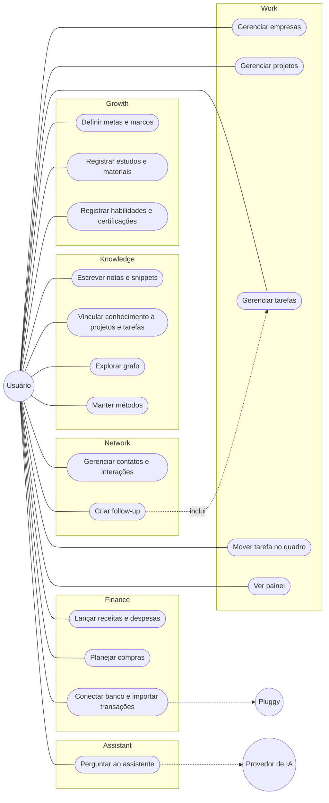
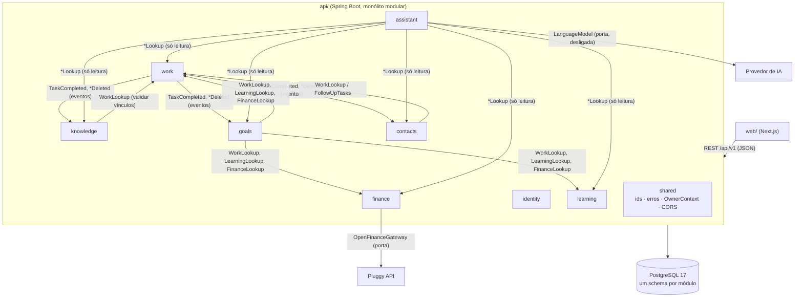
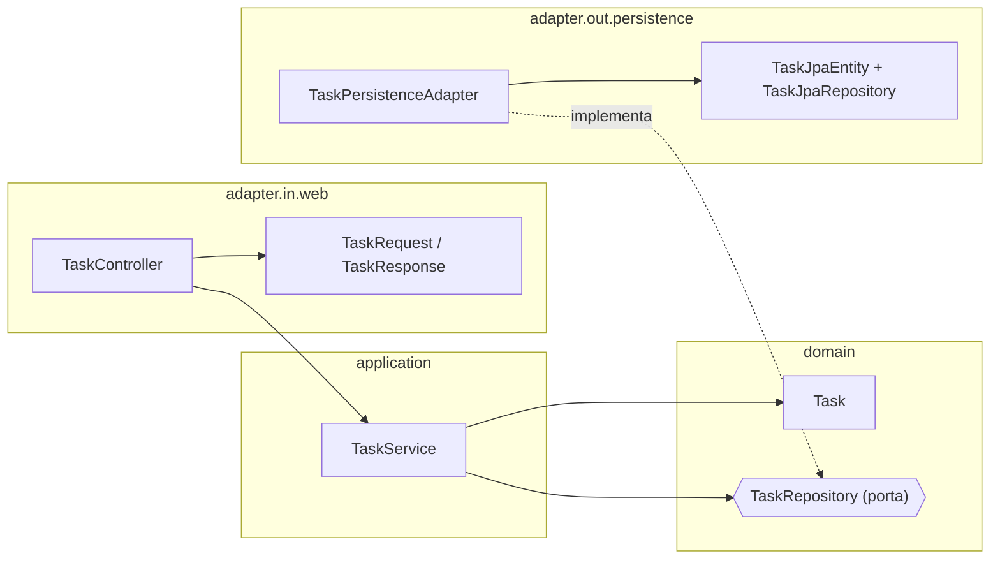
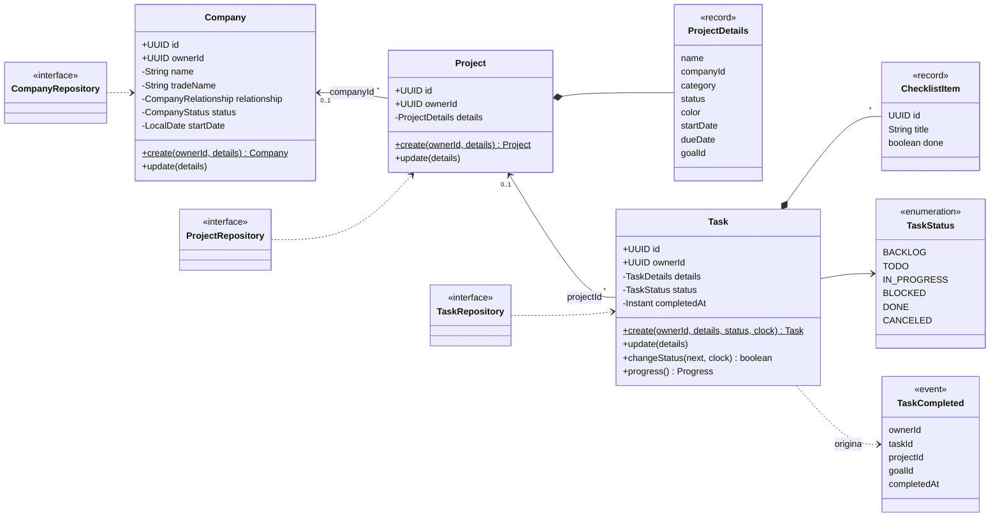
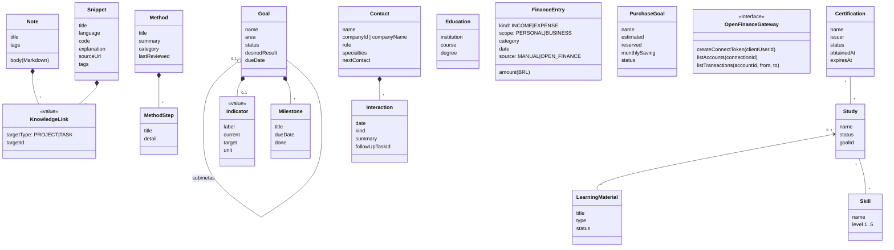
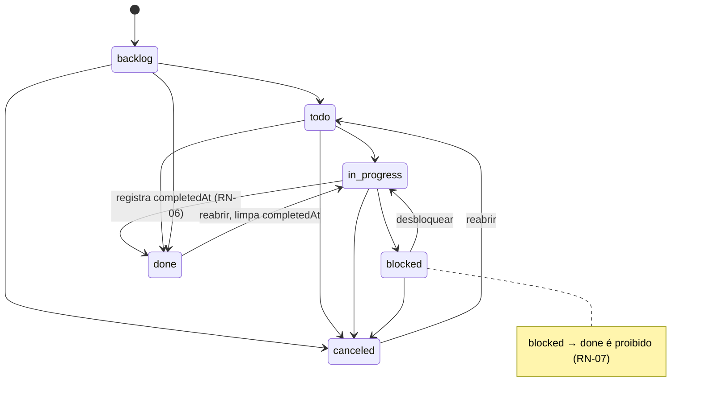
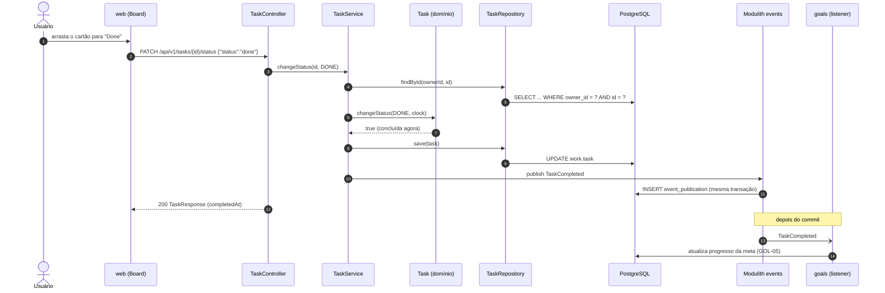
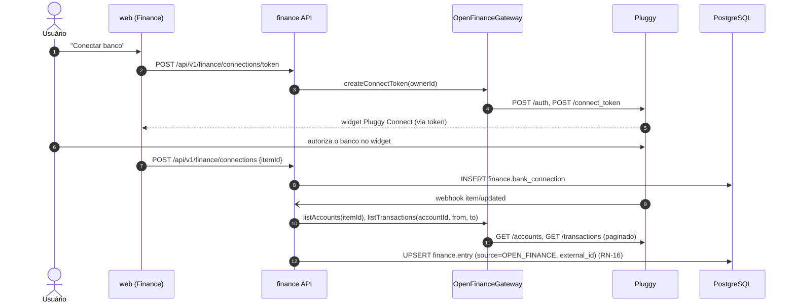
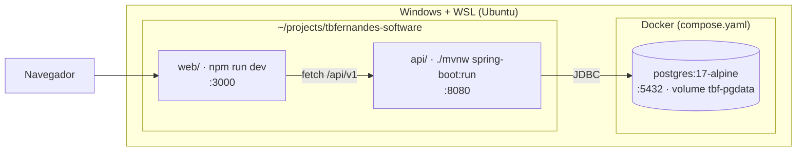

# Diagramas UML

Versão 0.1 · 2026-10-26

Os diagramas estão em Mermaid, que o GitHub e o VS Code mostram direto no Markdown. O diagrama de componentes gerado a partir do código fica em `api/target/spring-modulith-docs/` depois de `./mvnw test` (PlantUML/C4), e serve para conferir se este documento continua fiel ao código.

O modelo de dados (diagrama entidade-relacionamento) está em [modelo-de-dados.md](modelo-de-dados.md).

## 1. Casos de uso

Linhas tracejadas para atores externos indicam casos de uso planejados (fora do MVP).

## 2. Componentes (módulos)

Todos os módulos dependem de `shared`; essas setas foram omitidas.

## 3. Camadas (clean architecture) de um módulo

As setas apontam sempre para dentro: o domínio não conhece nenhuma outra camada.

## 4. Classes do domínio — Work

## 5. Classes do domínio — demais módulos

## 6. Estados da tarefa

## 7. Sequência — concluir tarefa no quadro

## 8. Sequência — sincronizar banco via Pluggy (planejada, épico FIN-OF)

## 9. Implantação local

