# Modelo de dados

Versão 0.1 · 2026-10-26 · Fonte da verdade: `tbfernandes-backend/src/main/resources/db/migration`

## 1. Convenções

- Um **schema por módulo**: `identity`, `work`, `knowledge`, `goals`, `learning`, `finance`, `contacts`. O registro de eventos do Spring Modulith (`event_publication`) fica em `public`.
- **Chave primária** `id uuid` (v7, gerada pela aplicação).
- **Raiz de agregado** tem `owner_id`, `created_at`, `updated_at` e `version` (concorrência otimista). Tabelas filhas (itens de checklist, passos, marcos, interações) herdam o dono da raiz.
- **Enums** em `text` com `CHECK`, valores em maiúsculas (ADR-004).
- **Dinheiro** em `numeric(14,2)`, BRL. Valores sempre positivos; o sentido vem de `kind`.
- **Listas simples** (tags, especialidades) em `text[]` com índice GIN.
- **FK só dentro do schema**. Referências entre módulos são `uuid` sem FK, marcadas com comentário na migração (ADR-003).

## 2. Diagrama entidade-relacionamento

Linhas sólidas são FKs; os campos `*_id` sem linha apontam para outro módulo.

```mermaid
erDiagram
    COMPANY ||--o{ PROJECT : "company_id"
    PROJECT ||--o{ TASK : "project_id"
    TASK ||--o{ TASK_CHECKLIST_ITEM : "task_id"

    NOTE ||--o{ NOTE_LINK : "note_id"
    SNIPPET ||--o{ SNIPPET_LINK : "snippet_id"
    METHOD ||--o{ METHOD_STEP : ""
    METHOD ||--o{ METHOD_EXAMPLE : ""

    GOAL ||--o{ GOAL : "parent_id"
    GOAL ||--o{ MILESTONE : "goal_id"

    STUDY ||--o{ MATERIAL : "study_id"
    STUDY ||--o{ STUDY_SKILL : ""
    SKILL ||--o{ STUDY_SKILL : ""
    CERTIFICATION ||--o{ CERTIFICATION_STUDY : ""
    STUDY ||--o{ CERTIFICATION_STUDY : ""

    CONTACT ||--o{ INTERACTION : "contact_id"

    APP_USER {
        uuid id PK
        varchar name
        varchar email UK
        varchar locale
        varchar time_zone
    }
    COMPANY {
        uuid id PK
        uuid owner_id
        varchar name
        varchar trade_name
        text relationship "CONTRACTOR|CLIENT|PARTNER|OWN"
        text status "ACTIVE|INACTIVE|CLOSED"
        date start_date
        varchar main_contact
    }
    PROJECT {
        uuid id PK
        uuid owner_id
        uuid company_id FK
        varchar name
        text category
        text status
        text color
        date start_date
        date due_date
        varchar next_delivery
        uuid goal_id "goals.goal"
    }
    TASK {
        uuid id PK
        uuid owner_id
        uuid project_id FK
        varchar title
        text status
        text priority
        varchar tag
        date start_date
        date due_date
        int checklist_done
        int checklist_total
        uuid goal_id "goals.goal"
        timestamptz completed_at
    }
    TASK_CHECKLIST_ITEM {
        uuid task_id PK, FK
        int position PK
        uuid id
        varchar title
        boolean done
    }
    NOTE {
        uuid id PK
        uuid owner_id
        varchar title
        text body
        text_array tags
        tsvector search "gerada"
    }
    SNIPPET {
        uuid id PK
        uuid owner_id
        varchar title
        varchar language
        text code
        varchar source_url
        text_array tags
    }
    NOTE_LINK {
        uuid note_id PK, FK
        text target_type PK "PROJECT|TASK"
        uuid target_id PK "work.*"
    }
    SNIPPET_LINK {
        uuid snippet_id PK, FK
        text target_type PK "PROJECT|TASK"
        uuid target_id PK "work.*"
    }
    METHOD {
        uuid id PK
        uuid owner_id
        varchar title
        text category
        date last_reviewed
    }
    METHOD_STEP {
        uuid method_id PK, FK
        int position PK
        varchar title
    }
    METHOD_EXAMPLE {
        uuid method_id PK, FK
        int position PK
        text content
    }
    GOAL {
        uuid id PK
        uuid owner_id
        uuid parent_id FK
        varchar name
        text area
        text status
        varchar desired_result
        date due_date
        numeric indicator_current
        numeric indicator_target
    }
    MILESTONE {
        uuid id PK
        uuid goal_id FK
        varchar title
        date due_date
        boolean done
    }
    STUDY {
        uuid id PK
        uuid owner_id
        varchar name
        text status
        uuid goal_id "goals.goal"
    }
    MATERIAL {
        uuid id PK
        uuid study_id FK
        varchar title
        text type
        text status
    }
    SKILL {
        uuid id PK
        uuid owner_id
        varchar name
        smallint level "1..5"
    }
    STUDY_SKILL {
        uuid study_id PK, FK
        uuid skill_id PK, FK
    }
    CERTIFICATION {
        uuid id PK
        uuid owner_id
        varchar name
        varchar issuer
        text status
        date obtained_at
        date expires_at
    }
    CERTIFICATION_STUDY {
        uuid certification_id PK, FK
        uuid study_id PK, FK
    }
    EDUCATION {
        uuid id PK
        uuid owner_id
        varchar institution
        varchar course
        text status
    }
    ENTRY {
        uuid id PK
        uuid owner_id
        text kind "INCOME|EXPENSE"
        text scope "PERSONAL|BUSINESS"
        varchar category
        numeric amount
        date entry_date
        boolean recurring
        text source "MANUAL|OPEN_FINANCE"
        varchar external_id
    }
    PURCHASE_GOAL {
        uuid id PK
        uuid owner_id
        varchar name
        numeric estimated
        numeric reserved
        numeric monthly_saving
        text status
        uuid goal_id "goals.goal"
    }
    CONTACT {
        uuid id PK
        uuid owner_id
        varchar name
        uuid company_id "work.company"
        varchar company_name
        text_array specialties
        date next_contact
    }
    INTERACTION {
        uuid id PK
        uuid contact_id FK
        date occurred_on
        text kind
        varchar summary
        uuid follow_up_task_id "work.task"
    }
```

## 3. Mapeamento frontend → banco

| Coleção do frontend (`AppData`) | Tipo TS | Tabela | Observações |
|---|---|---|---|
| `companies` | `Company` | `work.company` | |
| `projects` | `Project` | `work.project` | `goalId` → `goal_id` sem FK |
| `tasks` | `Task` | `work.task` + `work.task_checklist_item` | `checklist {done,total}` → `checklist_done/total`; `checklistItems` → tabela filha ordenada |
| `notes` | `Note` | `knowledge.note` + `knowledge.note_link` | `projectIds`/`taskIds` → linhas em `note_link` |
| `snippets` | `Snippet` | `knowledge.snippet` + `knowledge.snippet_link` | idem, em `snippet_link` |
| `methods` | `Method` | `knowledge.method` + `method_step` + `method_example` | `steps` e `examples` ordenados por `position` |
| `goals` | `Goal` | `goals.goal` | `indicator` → quatro colunas `indicator_*` |
| `milestones` | `Milestone` | `goals.milestone` | |
| `studies` | `Study` | `learning.study` + `learning.study_skill` | `skillIds` → tabela de junção |
| `materials` | `LearningMaterial` | `learning.material` | |
| `skills` | `Skill` | `learning.skill` | nome único por dono |
| `certifications` | `Certification` | `learning.certification` + `learning.certification_study` | `studyIds` → tabela de junção |
| `educations` | `Education` | `learning.education` | |
| `financeEntries` | `FinanceEntry` | `finance.entry` | `date` → `entry_date`; novos `source`, `external_id` para Open Finance |
| `purchases` | `PurchaseGoal` | `finance.purchase_goal` | |
| `contacts` | `Contact` | `contacts.contact` | `company_id` ou `company_name`, nunca os dois |
| `interactions` | `Interaction` | `contacts.interaction` | `date` → `occurred_on` |

Ids: o frontend usa ids curtos (`t-1a2b3c4d`); a API usa UUID. Na migração dos dados do navegador (RF-GEN-02), cada id antigo vira um UUIDv5 determinístico, o mesmo método usado no seed de `dev`.

## 4. Banco local

- `tbfernandes-backend/compose.yaml`: PostgreSQL 17 (`tbfernandes` / usuário `tbf` / senha `tbf`, porta 5432, volume `tbf-pgdata`).
- Perfil `dev` (padrão): aplica as migrações e o seed `db/dev/R__dev_seed.sql` com os mesmos registros de exemplo do frontend.
- Para olhar os dados: `docker compose exec postgres psql -U tbf -d tbfernandes`, depois `\dn` (schemas) e `\dt work.*`.
- Para recomeçar do zero: `docker compose down -v`.

## 5. Open Finance

`V11__open_finance.sql`. Sem FK para fora do schema.

| Tabela | Colunas principais | Notas |
|---|---|---|
| `finance.bank_connection` | `owner_id`, `external_id` (único, item da Pluggy), `institution`, `scope`, `status`, `last_synced_at`, `last_error` | raiz de agregado; o webhook acha o dono pelo `external_id` |
| `finance.bank_account` | PK (`connection_id`, `external_id`), `name`, `type`, `balance`, `currency` | filha da conexão, substituída a cada sincronização |

Transações importadas vão para `finance.entry` com `source = 'OPEN_FINANCE'` e `external_id` (RN-16).

## 6. Planejado

| Tabela | Épico | Motivo |
|---|---|---|
| `identity.session` ou Spring Session JDBC | IDN | login |
| `assistant.embedding` (pgvector) | AST | busca semântica para a IA |
